<p align="center">
  
</p>

<h1 align="center">Suniko Home</h1>

<p align="center">
  A calm, glanceable home screen for Samsung Tizen TVs: the time, the real sky outside,<br>
  your SmartThings home, and a developer hub, all readable from the couch.
</p>

<p align="center">
  <a href="https://github.com/onlyilkr/suniko-home-dashboard/actions/workflows/ci.yml"></a>
  <a href="https://github.com/onlyilkr/suniko-home-dashboard/releases"></a>
  <a href="LICENSE"></a>
  
  
  
  <a href="CONTRIBUTING.md"></a>
</p>

<p align="center"><a href="README.tr.md">Türkçe</a></p>

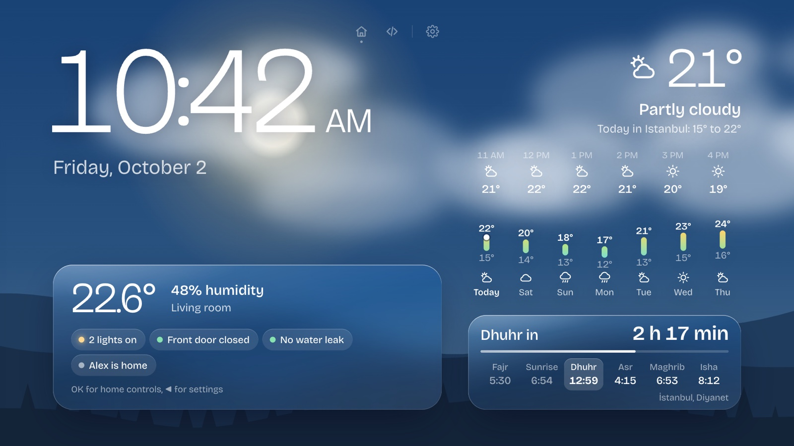

Suniko Home turns the TV into an ambient display. Outside information (clock, date, weather) is painted directly onto a sky that follows the real time, sunrise, sunset and weather; everything about the home lives on liquid-glass panels. It is plain HTML, CSS and ES5 JavaScript: no framework, no build step, no tracking, and it keeps working from its cache when the network drops.

**Try it in your browser in 30 seconds**, no TV and no SmartThings account needed:

```bash
git clone https://github.com/onlyilkr/suniko-home-dashboard.git && cd suniko-home-dashboard
python3 dev-server.py          # then open http://127.0.0.1:8770/?demo
```

## Contents

- [Features](#features)
- [Requirements](#requirements)
- [Install on your TV](#install-on-your-tv)
- [Remote control](#remote-control)
- [Configuration](#configuration)
- [Demo mode](#demo-mode)
- [How it is built](#how-it-is-built)
- [Privacy](#privacy)
- [Data sources and licenses](#data-sources-and-licenses)
- [FAQ](#faq)
- [Roadmap](#roadmap)
- [Contributing](#contributing)
- [Acknowledgements](#acknowledgements)

## Features

<p align="center">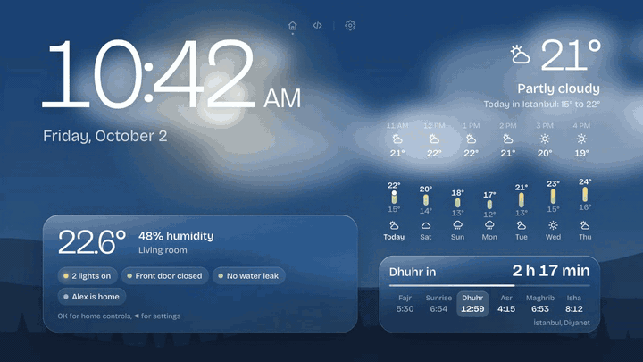</p>
<p align="center"><sub>A 20-second tour with the remote, recorded in demo mode.</sub></p>

### At a glance

A large clock in three styles (the round faces are much easier to read for older eyes), the date, current weather, the next six hours and a compact seven-day strip with day/night temperature bars and a weather icon per day ([Open-Meteo](https://open-meteo.com/)). 12/24-hour time follows the TV's locale. When rain is likely within three hours, a heads-up slides down.

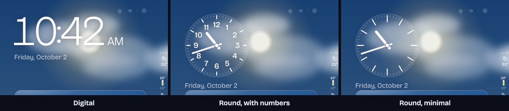

### The sky is the background

The default **Weather** theme draws the real conditions outside: sun with rays or moon and stars, drifting clouds, rain, snow, fog, lightning, and hills at the horizon. The sky itself follows the actual time, sunrise and sunset.

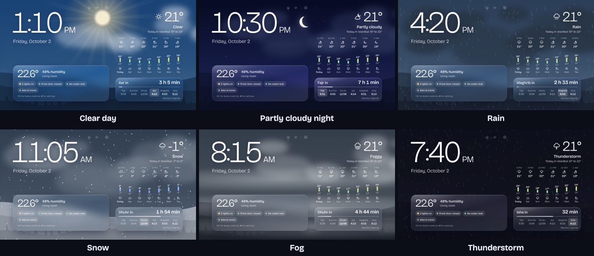

Other themes: **Live sky** (a gradient that follows the time and cloud cover, with the sun's glow arcing across the screen), **Colors of the day** (soft abstract colors that shift with the hour), **Dark**, and eight **photo themes** (autumn, forest, sea, mountains, winter, city, stars, space) from Wikimedia Commons featured pictures that change every ten minutes and always show their author and license. The photo themes are not pictured here because each photo has its own license.

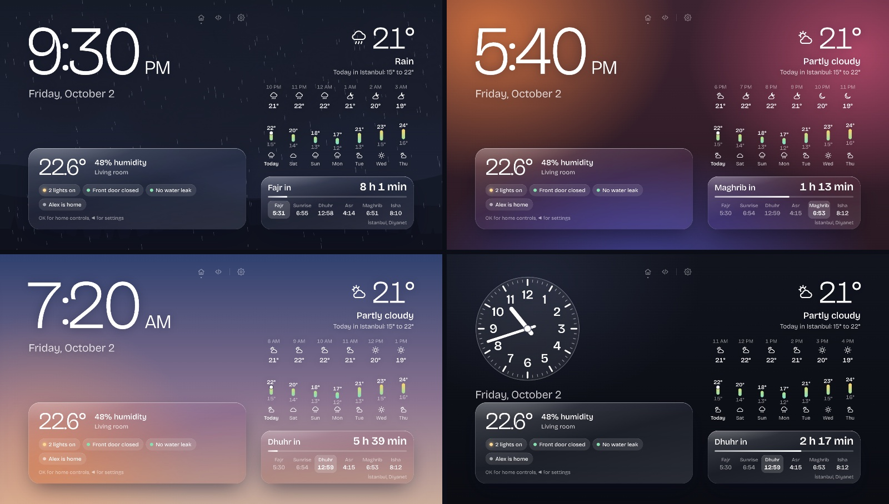

### Smart home (optional, SmartThings)

The indoor panel shows temperature and humidity plus door, leak, light, battery and presence status. Press **OK** for the home controls: devices grouped by room, lights and plugs that switch instantly (rolled back if the command fails), and scenes that run with one press. OAuth tokens renew themselves on the TV; a small helper script (`st_auth.py`) walks you through the one-time authorization.

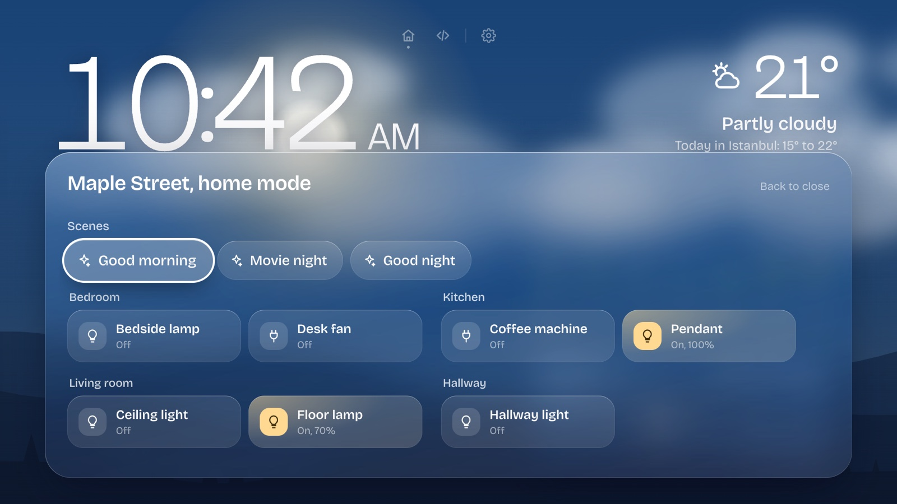

Notifications slide down in liquid glass when a door opens, a leak is detected, someone arrives or leaves, a battery runs low, rain is expected, or a prayer time is near. Newest on top, at most three at a time.

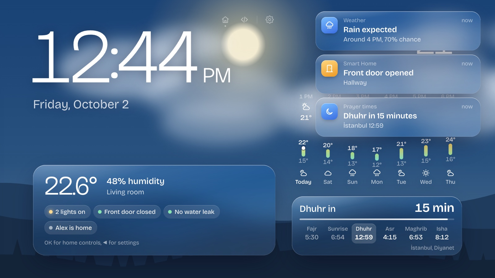

### Developer hub

A second screen in a departures-board style: the **Hacker News** front page in HN's own order, the **most-starred GitHub repositories** created this week, and live **service status** for Claude (claude.ai, API, Claude Code) and GitHub. A notification appears on any screen when a pinned service degrades or recovers. No keys or accounts needed, and it can be hidden in settings.

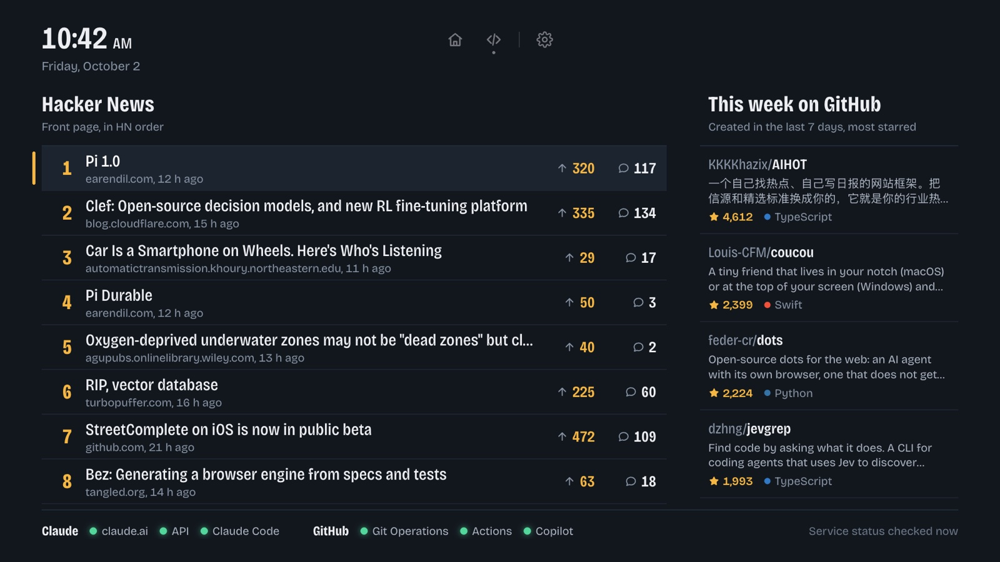

Press **OK** on a story or a repository for details, with a **QR code** to continue on your phone.

| | |
|---|---|
| 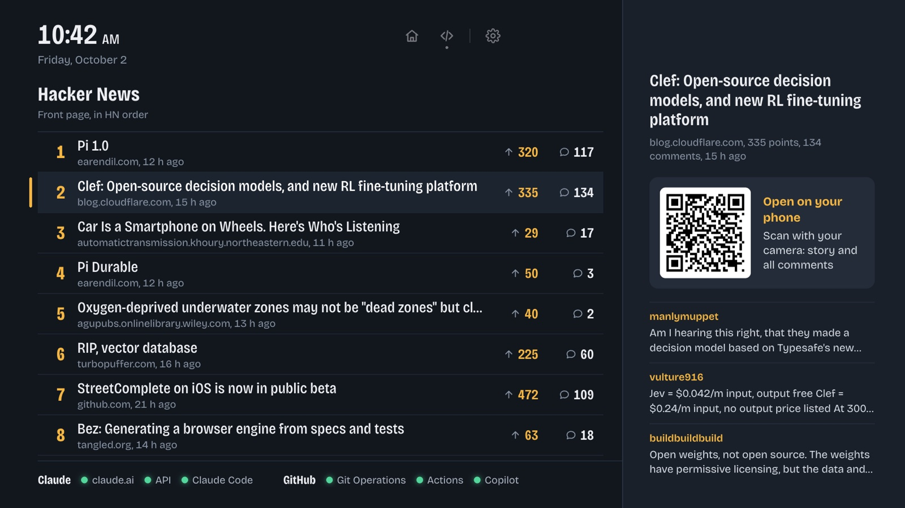 | 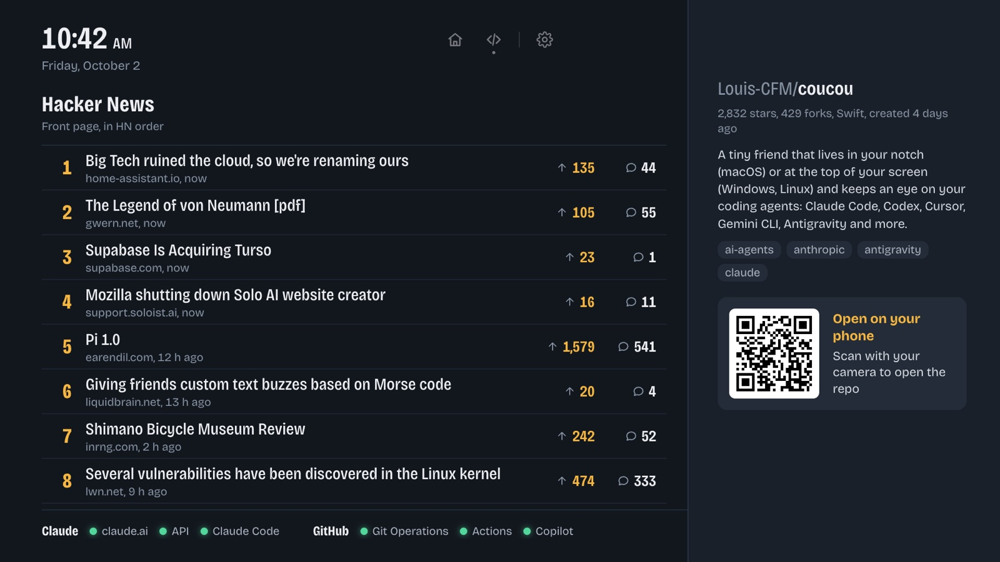 |
| **Story**: the full title, points, comments and the top three comments | **Repository**: description, stars, forks, language and topics |

### Prayer times (optional)

The next prayer with a countdown and the day's six times (visible on the home screen above). In Turkey, the official Diyanet times per district; elsewhere calculated with [Aladhan](https://aladhan.com/) using the region's method. The location is automatic, or picked from a province and district list; reminders arrive 15 minutes before and on time.

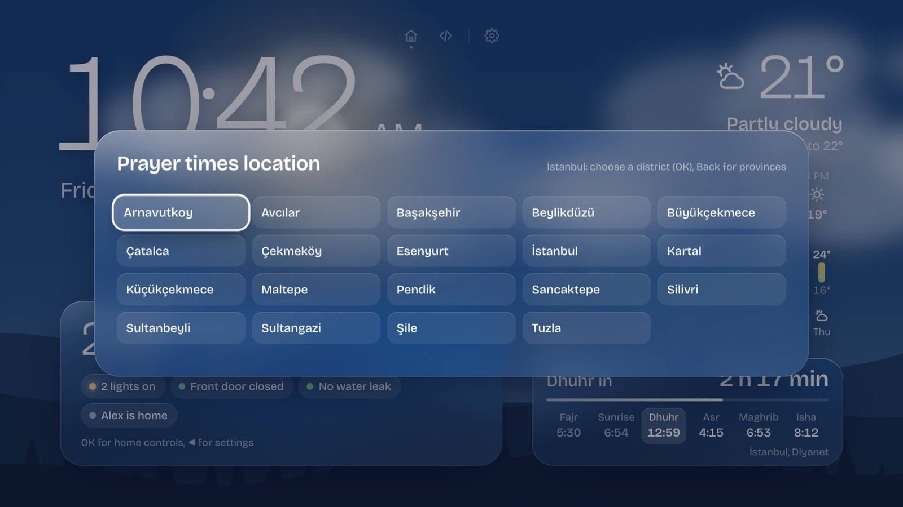

### Made for a TV

Everything works with the arrow keys, **OK** and **Back**. Press **▲** for the top menu, **◀** for settings. Settings apply instantly, are stored on the TV, and the drawer docks on the side away from what it changes so you see the result live.

<p align="center">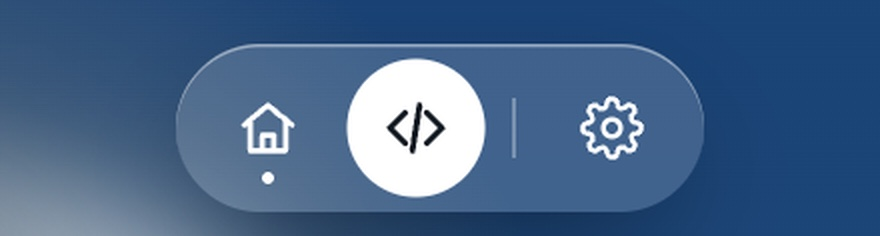</p>

| | |
|---|---|
| 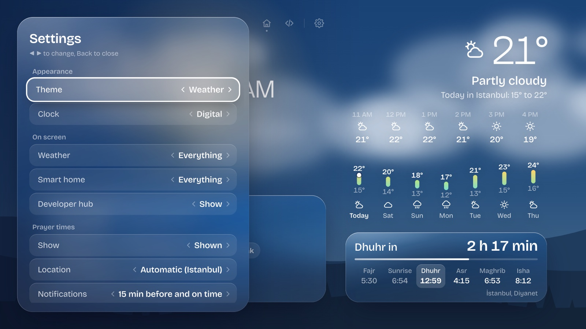 | 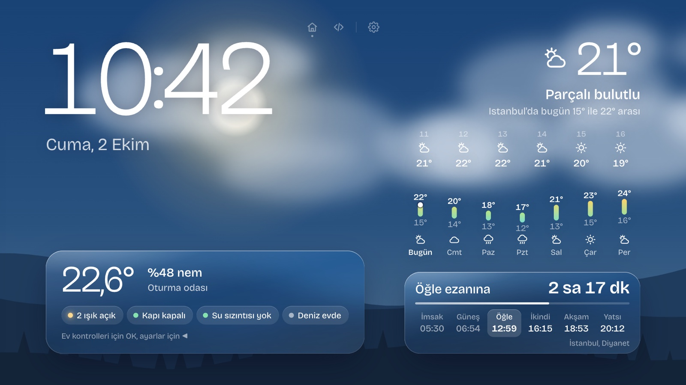 |
| **Settings**: theme, clock, sections, smart home, developer hub, prayer times, language and unit | **Languages**: English and Turkish, with locale-aware dates, numbers, °C/°F and 12/24-hour time |

The app is tuned for TV GPUs: no blur on moving panels, a small compositing budget for the animated scene, and animations that pause under open panels. See [ARCHITECTURE.md](ARCHITECTURE.md#performance-rules).

## Requirements

| | |
|---|---|
| **TV** | Samsung Smart TV with Tizen 6.5 or newer, in Developer Mode |
| **Computer** | macOS, Windows or Linux on the same network as the TV |
| **Tizen Studio** | With the TV Extension and the Samsung Certificate Extension ([install guide](https://developer.samsung.com/smarttv/develop/getting-started/setting-up-sdk/installing-tv-sdk.html)) |
| **Certificate** | A free Samsung developer certificate tied to your TV's DUID |
| **Python** | 3.8 or newer, for `build.sh` helpers, `st_auth.py` and the desktop preview |
| **Node.js** | 18 or newer, only for the tests and checks (`npm test`) |
| **SmartThings** | Optional; a Samsung account and the SmartThings CLI (run with `npx`) |

### Compatibility

| TV | Tizen | Status |
|---|---|---|
| Samsung QN85D (2024, Neo QLED) | 9.0 | Tested daily |

Running it on another model? Please [open an issue](https://github.com/onlyilkr/suniko-home-dashboard/issues/new/choose) with the model and Tizen version so it can be added here.

## Install on your TV

The full walkthrough, from enabling Developer Mode to the first launch, is in **[docs/SETUP.md](docs/SETUP.md)**. In short:

```bash
cp app/config.example.js app/config.js            # optional: location, defaults
python3 st_auth.py url                            # optional: SmartThings, see SETUP §6
TV_IP=192.168.1.50 CERT_PROFILE=my-profile ./build.sh
```

`build.sh` packages and signs the app, installs it over `sdb`, and launches it. Re-running it updates the app; settings and tokens stored on the TV survive.

## Remote control

| Where | Keys |
|---|---|
| Home screen | **▲** top menu · **OK**, **▼** or **▶** home controls · **◀** settings |
| Top menu | **◀ ▶** choose · **OK** or **▼** open · **Back** leave (it also fades out by itself after 8 s, without choosing anything) |
| Home controls | arrows move · **OK** switches a device or runs a scene · **Back** closes |
| Settings | **▲ ▼** row · **◀ ▶** change · **OK** changes, or opens the picker on the theme and location rows · **Back** closes |
| Developer hub | **▲ ▼** list · **▶ ◀** Hacker News / GitHub · **OK** details · **Back** closes, then returns home |

## Configuration

Everything works without configuration. To set defaults, copy `app/config.example.js` to `app/config.js` (ignored by git):

| Key | Values | Default |
|---|---|---|
| `location` | `{ lat, lon, name }` or `null` (IP, then the SmartThings home) | `null` |
| `fallbackLocation` | `{ lat, lon, name, region, country }` used when no location can be found | `null` |
| `display.theme` | `weather`, `sky`, `daylight`, `dark`, `autumn`, `forest`, `sea`, `mountains`, `winter`, `city`, `stars`, `space` | `weather` |
| `display.clock` | `digital`, `classic`, `minimal` | `digital` |
| `display.weather` | `full`, `hourly`, `weekly`, `now` | `full` |
| `display.home` | `full`, `climate`, `off` | `full` |
| `display.devhub` | `on`, `off` | `on` |
| `display.prayer` / `prayerNote` | `on`, `off` / `both`, `at`, `off` | `off` / `both` |
| `display.lang` / `unit` | `auto`, `en`, `tr` / `auto`, `c`, `f` | `auto` |
| `smartthings.climateDeviceId` | device ID of the sensor for the indoor panel | first sensor found |
| `smartthings.hide` | device IDs or names to leave out | `[]` |
| `demo` | `true` for the sample home and a fixed forecast | `false` |

Choices made in the on-screen settings are stored on the TV and take precedence over these defaults.

## Demo mode

Add `?demo` to the preview address (or set `demo: true`) to replace SmartThings and the forecast with a sample home and fixed weather for Istanbul. Nothing is sent anywhere: switching a light only changes the screen. `?demo=rain`, `snow`, `storm`, `fog`, `clear` or `overcast` picks the weather. The screenshots above were taken this way.

## How it is built

```
app/
  index.html        markup and the home screen styles (design tokens in :root)
  app.js            clock, sky, weather, home panels, settings, notifications, remote keys
  screens.js        top menu and screen switching (screens are layers, no page reloads)
  devhub.js, dev.css    developer hub screen
  hn.js, github.js, status.js    Hacker News, GitHub and service status data, cached
  weather.js, smartthings.js, prayer.js, themes.js, scene.js    data sources and the weather scene
  demo.js           sample home and forecast for ?demo
  i18n.js, i18n/    translations and locale formats
dev-server.py       desktop preview with a SmartThings proxy
st_auth.py          SmartThings OAuth setup and preview token renewal
build.sh            package, sign, install and launch on the TV
tools/              translation check and unit tests (Node, no dependencies)
```

Read **[ARCHITECTURE.md](ARCHITECTURE.md)** for the data flow, the key routing, the caching and offline behavior, the OAuth design and the TV performance rules.

## Privacy

- No analytics, no accounts of its own, no server: the TV talks directly to the public APIs listed below.
- SmartThings is optional. Tokens are created on your computer, bundled into your own build, then stored and renewed on the TV. Secrets live in `secrets/` and `app/secrets.js`, which are ignored by git.
- The developer hub uses only public, unauthenticated endpoints.

## Data sources and licenses

- **Weather**: [Open-Meteo](https://open-meteo.com/en/terms), free for non-commercial use, CC BY 4.0.
- **Location**: [ipwho.is](https://ipwho.is/) IP geolocation.
- **Prayer times**: in Turkey, Diyanet times via [ezanvakti.emushaf.net](https://ezanvakti.emushaf.net) (an unofficial mirror of Diyanet data); elsewhere [Aladhan](https://aladhan.com/prayer-times-api).
- **Theme photos**: [Wikimedia Commons featured pictures](https://commons.wikimedia.org/wiki/Commons:Featured_pictures), each under its own free license (mostly CC BY-SA); author and license are shown on screen.
- **Home**: [SmartThings API](https://developer.smartthings.com/docs/api/public) with your own authorization.
- **Developer hub**: [Hacker News API](https://github.com/HackerNews/API) and [HN Search by Algolia](https://hn.algolia.com/api), the [GitHub search API](https://docs.github.com/en/rest/search) without a token, and the [Claude](https://status.claude.com) and [GitHub](https://www.githubstatus.com) status pages.
- **QR codes**: [qrcode-generator](https://github.com/kazuhikoarase/qrcode-generator) by Kazuhiko Arase, MIT (`app/vendor/qrcode.js`, license in `app/vendor/qrcode.LICENSE.txt`).
- **Font**: [Bricolage Grotesque](https://github.com/ateliertriay/bricolage), SIL Open Font License 1.1 (`app/fonts/OFL.txt`).

## FAQ

**Is there a ready-made `.wgt` to download?**
No. Samsung only installs apps signed with a certificate that includes your TV's DUID, so everyone builds and signs their own package with `build.sh`. It takes a few minutes once Tizen Studio is set up.

**Does it need SmartThings?**
No. Without SmartThings credentials the home panel is simply hidden; the clock, weather, themes, prayer times and the developer hub work on their own.

**Does it replace the TV's home screen or start with the TV?**
It is a regular app with a tile in Smart Hub. Open it from there; it keeps running in the background when you switch to another app and resumes where you left it.

**Can it burn in an OLED screen?**
Static elements (the clock and the panels) shown for many hours can cause image retention on OLED TVs. The app does not shift pixels yet (see the roadmap); on OLED models, use the TV's own screen-protection settings and avoid leaving it on all day. LCD and Neo QLED (mini-LED) TVs are not affected.

**Why ES5 and no framework?**
Older Tizen engines run this code, and a TV has a small CPU and GPU budget. Plain scripts start fast, need no build step, and are easy to read.

**The home panel says "SmartThings disconnected".**
The refresh token expires if the TV stays off for more than 30 days, or the app's storage was cleared. Authorize the TV again and rebuild ([SETUP §6](docs/SETUP.md#6-smartthings-optional)).

## Roadmap

- Pixel shifting for OLED screens
- Light brightness control from the home controls
- More languages (translations are a single dictionary file)
- A Playwright smoke test of the demo mode in CI
- Splitting `app.js` into smaller modules (sky, settings, panels, notifications)

Ideas and votes are welcome in [issues](https://github.com/onlyilkr/suniko-home-dashboard/issues).

## Contributing

Issues and pull requests are welcome. **[CONTRIBUTING.md](CONTRIBUTING.md)** covers the development loop, the rules every change follows (ES5, both languages, TV performance) and the checks to run.

## Security

Your build contains your own SmartThings credentials; see **[SECURITY.md](SECURITY.md)** for how secrets are handled and how to report a vulnerability privately.

## Acknowledgements

The Tizen packaging and install scripts started from [gursuyaman1/tizen-tv-dashboard-ai](https://github.com/gursuyaman1/tizen-tv-dashboard-ai) by Gürsu Yaman; the interface and everything above was written from scratch.

## License

[MIT](LICENSE). Bundled third-party files keep their own licenses (see above).

Suniko Home is an independent project and is not affiliated with or endorsed by Samsung, SmartThings, Anthropic, GitHub or Y Combinator. Product names are used only to describe compatibility and data sources.
